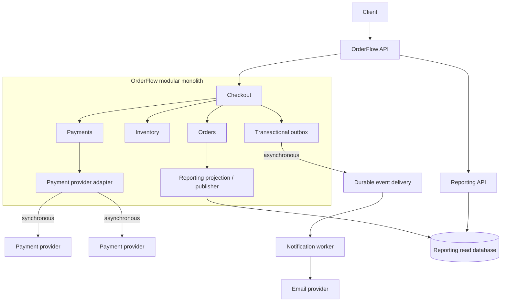

# 1. Current Architecture

Застосунок працює як **modular monolith**: усі модулі виконуються в одному процесі, використовують спільну in-memory database та входять до одного deployment artifact.

## Модулі

| Модуль | Відповідальність |
|---|---|
| Orders | Створення замовлень і керування їхніми статусами |
| Inventory | Перевірка доступності та резервування товарів |
| Payments | Інтеграція з платіжним провайдером і обробка платежів |
| Notifications | Формування та синхронне надсилання email |
| Reporting | Формування звітів на основі операційних даних |
| Checkout | Координація процесу оформлення замовлення |

## Аналіз поточної архітектури

OrderFlow працює три роки та обробляє продажі електроніки. Оскільки Checkout безпосередньо впливає на revenue, його доступність і час відповіді є критичними для бізнесу.

Модулі мають різну частоту змін і різні вимоги до продуктивності та надійності, але використовують спільний deployment. Це збільшує координаційні витрати та обмежує можливість незалежного розгортання. Синхронні виклики зовнішніх провайдерів додатково створюють ризик поширення затримок і відмов на Checkout.

Engineering metrics підтверджують погіршення maintainability та deployability: час розробки функціоналу зріс утричі, Average PR Size — майже втричі, а кількість модулів, яких торкається зміна, збільшилася з 1,7 до 4,3. Одночасно зросли rollback rate, deployment duration, кількість product incidents і Mean Time to Restore (MTTR). Це свідчить про збільшення вартості змін і ризику релізів.

### Основні проблеми

- **Deployability:** зміни окремих модулів потребують тестування та розгортання всього застосунку.
- **Modifiability:** зростання кількості модулів, яких торкається одна зміна, ускладнює розробку та збільшує координаційні витрати.
- **Reliability та resilience:** синхронні залежності від зовнішніх провайдерів можуть спричиняти каскадні збої; зростання кількості інцидентів і MTTR посилює це занепокоєння.
- **Availability:** повільний або недоступний платіжний провайдер і синхронне надсилання email можуть погіршувати доступність оформлення замовлень.
- **Performance та scalability:** Reporting конкурує за ресурси з операційними сценаріями, а очікуване зростання навантаження може посилити цей ефект.

### Пріоритетність архітектурних характеристик

1. **Availability** — Checkout має залишатися доступним навіть за проблем із другорядними компонентами.
2. **Reliability та resilience** — замовлення, резервування товарів і платежі мають оброблятися коректно, зокрема за повторних запитів і часткових відмов.
3. **Modifiability та deployability** — зменшення кількості модулів, яких торкається зміна, та ризику релізів.
4. **Performance та scalability** — захист Checkout від затримок зовнішніх залежностей і зростання навантаження Reporting.
5. **Maintainability** — спрощення тестування, діагностики та подальшого розвитку системи.

## 2. Proposed architecture

## 3. Decision summary

### Notification як окремий сервіс

**Problems & Evidences**

Згідно зі сценарієм A (*Change Scenario A*), Marketing team хоче змінювати шаблони повідомлень, теми листів і правила сегментації 2–3 рази на тиждень. Більшість цих змін не впливає на бізнес-логіку checkout, проте через спільний deployment вони потребують тестування та розгортання всього моноліту.

Крім того, надсилання повідомлень зараз виконується синхронно в межах checkout flow. Оскільки доставка email не визначає успішність оформлення замовлення, очікування відповіді поштового провайдера створює зайву затримку та може негативно впливати на доступність checkout.

**Decision**

Виділити Notifications в окремий сервіс із незалежним deployment. Запровадити надійний асинхронний механізм передавання подій від основного OrderFlow до Notification service.

Після успішного оформлення замовлення OrderFlow має передати подію про його завершення, не очікуючи на доставку email. Notification service оброблятиме події у фоновому режимі.

Для забезпечення надійності доставки необхідно передбачити повторні спроби після тимчасових помилок, контроль дублікатів, обробку повідомлень, які не вдалося доставити після встановленої кількості спроб, і моніторинг черги.

**Benefits**

- **Зменшення runtime coupling:** час відповіді checkout більше не залежить від часу доставки email. Тимчасова недоступність поштового провайдера не повинна перешкоджати успішному оформленню замовлення.
- **Зменшення deployment coupling:** зміни шаблонів, тем листів і правил сегментації можна розгортати незалежно від основного OrderFlow.
- **Підвищення ізоляції відмов:** проблеми в Notification service або поштового провайдера не повинні призводити до відмови checkout, якщо механізм асинхронної доставки працює належним чином.
- **Можливість незалежного масштабування:** Notification service можна масштабувати відповідно до обсягу повідомлень, не збільшуючи ресурси основного застосунку.
- **Гнучкіша обробка помилок:** тимчасові збої поштового провайдера можна компенсувати повторними спробами без повторного оформлення замовлення.

**Trade-offs**

- **Додаткові витрати:** окремий сервіс потребує додаткової інфраструктури, моніторингу, deployment pipeline та часу на підтримку. Для команди з обмеженими ресурсами це збільшує операційну складність, хоча не обов'язково потребує створення окремої команди.
- **Мережеві помилки:** передавання подій між компонентами створює нові точки відмови. Потрібні обробка недоступності брокера, повторні спроби публікації та відновлення після збоїв.
- **Затримка доставки:** асинхронна обробка не гарантує миттєвого надсилання повідомлення. Під час пікового навантаження або збоїв черга може накопичуватися.
- **Ризик дублювання:** повторна обробка подій може спричинити надсилання кількох однакових листів. Потрібно передбачити ідемпотентну обробку, де це можливо, та контроль повторної доставки.
- **Ускладнення діагностики:** помилки можуть виникати вже після успішної відповіді checkout. Потрібні кореляція подій із замовленнями, журналювання та моніторинг затримки черги.
- **Ризик втрати повідомлень:** якщо замовлення успішно збережене, але подію не вдалося надійно передати, сповіщення може не надійти. Для зменшення цього ризику варто розглянути Transactional Outbox або інший механізм надійної публікації подій.

**How we will measure success**

- Checkout p95 latency — зменшується після усунення синхронного надсилання email.
- Час незалежного deployment Notifications — скорочується порівняно з поточним процесом.
- Modules Changed per Notification Feature — зменшується кількість модулів, яких торкається зміна шаблону.
- Notification delivery success rate — частка повідомлень, успішно доставлених у погоджений часовий інтервал, залишається на цільовому рівні.
- Queue processing lag — затримка між створенням події та початком її обробки не перевищує погодженого порогу.

**Умови перегляду рішення**

Якщо незалежне розгортання Notifications не скорочує час delivery або операційні витрати перевищують отриману користь, варто переглянути доцільність окремого сервісу. Якщо ж ізоляція відмов і незалежні релізи дають вимірюваний ефект, це обґрунтовує подальшу еволюцію архітектури в цьому напрямку.

### Поступове відокремлення Reporting

**Problems & Evidences**

Згідно зі сценарієм C (*Change Scenario C*), протягом наступних 12 місяців навантаження на Reporting може зрости у 8–10 разів. Finance team потребує звітів за довші періоди, а Product Analytics — частіших запитів. При цьому затримка даних на кілька хвилин є прийнятною для більшості звітів.

Наразі Reporting працює в межах модульного моноліту та використовує спільну базу даних з операційними модулями. Зростання кількості й складності звітних запитів може збільшити навантаження на спільне сховище та конкурувати за ресурси з checkout. Це створює ризик погіршення продуктивності й доступності основних бізнес-операцій.

**Decision**

Відокремлювати Reporting поступово, не створюючи окремий сервіс одразу.

На першому етапі створити окрему read model (модель читання), оптимізовану для звітів, і забезпечити передавання до неї змін з операційного сховища. Звітні запити мають виконуватися на основі цієї моделі, не створюючи значного додаткового навантаження на основні бізнес-операції.

На наступному етапі, якщо метрики підтвердять потребу в незалежному масштабуванні або deployment, виділити Reporting в окремий сервіс із власною базою даних для читання.

Для оновлення read model варто розглянути інкрементальну синхронізацію через події або журнал змін. Механізм синхронізації має підтримувати відновлення після помилок, повторну обробку змін і контроль затримки оновлення.

**Benefits**

- **Ізоляція навантаження на базу даних:** звітні запити виконуватимуться на окремій read model, що зменшить конкуренцію за ресурси з операційними запитами. Основне сховище все одно зазнаватиме навантаження від передавання змін.
- **Захист продуктивності checkout:** важкі звітні запити менше впливатимуть на ресурси, необхідні для оформлення замовлень і виконання інших критичних операцій.
- **Можливість незалежного масштабування:** окрему базу даних можна оптимізувати під аналітичні запити, індекси та довгі часові діапазони, не змінюючи основне сховище.
- **Підготовка до незалежного deployment:** чітка межа між Reporting та операційними модулями спрощує майбутнє виділення окремого сервісу. Саме створення read model ще не забезпечує незалежного розгортання.
- **Можливість оптимізувати дані під звіти:** замість копіювання всіх операційних таблиць можна зберігати необхідні проєкції та агрегати, якщо це відповідає запитам Reporting.

**Trade-offs**

- **Додаткові витрати:** окрема база даних, механізм синхронізації, моніторинг і подальший сервіс збільшують інфраструктурні та операційні витрати. Окрема команда не є обов'язковою, але відповідальність за підтримку зростає.
- **Затримка актуальності даних:** read model оновлюється не миттєво, тому звіти можуть тимчасово відображати застарілу інформацію. Потрібно визначити допустиму затримку для різних типів звітів.
- **Складність синхронізації:** помилки, повторна доставка або неправильний порядок обробки змін можуть спричинити пропущені чи дубльовані записи та некоректні агрегати.
- **Додаткове навантаження на основне сховище:** читання звітів буде ізольоване, але отримання змін для read model усе одно споживатиме ресурси операційної системи.
- **Ускладнення відновлення та діагностики:** потрібно контролювати відставання синхронізації, виявляти пропущені зміни та забезпечувати повторне формування read model у разі пошкодження або втрати даних.
- **Передчасне ускладнення архітектури:** якщо поточне навантаження ще не створює проблем, окрема база та механізм синхронізації можуть збільшити складність раніше, ніж з'явиться відчутна бізнес-користь.

**How we will measure success**

- **Reporting query p95 latency:** час виконання звітних запитів не перевищує погодженого порогу навіть за навантаження, збільшеного у 8–10 разів.
- **Checkout p95 latency:** час відповіді checkout не погіршується зі зростанням навантаження Reporting.
- **Read model lag:** затримка між зміною в операційному сховищі та її появою в Reporting залишається в межах кількох хвилин.
- **Database resource utilization:** зменшується конкуренція між звітними та операційними запитами за ресурси основного сховища.
- **Reporting deployment lead time:** після виділення окремого сервісу час доставки змін Reporting скорочується порівняно з поточним процесом.

**Умови перегляду рішення**

На першому етапі достатньо ізолювати модель читання, залишивши Reporting частиною модульного моноліту, якщо це дає змогу ефективно відокремити навантаження.

Виділення незалежного Reporting service варто розглядати, якщо звітні запити потребують окремого масштабування, зміни Reporting регулярно затримують релізи інших модулів або ізоляції бази даних недостатньо для дотримання performance requirements.

Якщо ж окрема read model не забезпечує потрібної продуктивності, слід спочатку переглянути структуру даних, індекси, агрегати та механізм синхронізації, перш ніж автоматично переходити до окремого сервісу.

### Посилення меж відповідальності Payments module

**Problems & Evidences**

Згідно з engineering metrics:

> За останній квартал 48% feature PR торкалися Orders і Payments одночасно.

Згідно з product roadmap:

> Payments змінюється частіше через нові fraud rules, способи оплати та вимоги Finance team.

Додаткові вимоги описані у change scenarios B та F:

- **Scenario B:** необхідно додати другого payment provider для іншого регіону, передбачити fallback під час його недоступності та врахувати іншу модель помилок і асинхронне підтвердження частини платежів.
- **Scenario F:** необхідно додати знижки для певних способів оплати та наборів товарів. Правила змінюватимуться щомісяця, а Finance потребує коректного відображення знижок у Reporting. Користувач повинен бачити остаточну суму до списання коштів.

Часті зміни Payments та одночасні зміни Orders і Payments можуть свідчити про недостатньо чіткі межі відповідальності між модулями або про надмірну залежність їхніх реалізацій. Проте сама метрика у 48% не доводить наявності прямого архітектурного зв'язку: перед зміною структури необхідно перевірити, які саме зміни змушують команди редагувати обидва модулі.

Додавання нового провайдера та знижок збільшує важливість чіткого розподілу відповідальності. Payments має приховувати специфіку платіжних провайдерів, тоді як Checkout повинен координувати процес оформлення замовлення. Логіка розрахунку знижок має бути відокремлена від виконання платежу.

**Decision**

Залишити Payments у складі поточного модульного моноліту, але посилити його межі та контракти взаємодії з Checkout і Orders.

На цьому етапі передчасно виділяти Payments в окремий сервіс. Поточна інтеграція з провайдером є синхронною, а окремий сервіс додасть мережеву взаємодію, нові потенційні точки відмови та витрати на розгортання й підтримку. Водночас саме по собі синхронне очікування платежу не забороняє виділення сервісу в майбутньому: рішення залежатиме від того, чи виправдовують незалежне розгортання та ізоляція відмов додаткову складність.

Рішення передбачає такі зміни:

1. Визначити чіткий контракт Payments.
2. Прибрати прямий доступ Payments до Orders repository.
3. Ізолювати інтеграції з провайдерами через адаптери.
4. Залишити розрахунок знижок поза Payments.
5. Передбачити розширення контракту для асинхронних платежів.

**Benefits**

- **Менше зв'язності між модулями.** Зміни внутрішньої реалізації Payments не повинні вимагати змін у Checkout або Orders, якщо їхній контракт залишається незмінним.
- **Простіше додавати провайдерів.** Новий провайдер реалізується через адаптер, який перетворює його специфічну поведінку на внутрішній контракт Payments.
- **Чіткіший розподіл відповідальності.** Checkout координує оформлення замовлення, Pricing визначає остаточну суму, Payments виконує платіж, а Orders зберігає стан замовлення.
- **Менший радіус впливу змін.** За умови стабільних контрактів зміни платіжної інтеграції рідше вимагатимуть одночасного редагування кількох модулів.
- **Підготовка до можливого виділення сервісу.** Явні контракти та відсутність прямого доступу до внутрішніх репозиторіїв спрощують майбутнє відокремлення Payments, якщо для цього з'являться достатні підстави.
- **Збереження простоти розгортання на поточному етапі.** Модуль залишається в моноліті, тому не потребує окремого deployment pipeline та додаткової інфраструктури.

Очікується, що ці зміни зменшать частку feature PR, які одночасно торкаються Orders і Payments. Проте зменшення Average PR Size та Modules Changed per Feature потрібно перевірити за фактичними метриками після впровадження змін. Розмір тестового набору також не обов'язково зменшиться: натомість тести можуть стати краще ізольованими, а кількість необхідних наскрізних перевірок — зменшитися.

**Trade-offs**

- **Залежність від зовнішнього провайдера залишається.** Якщо Checkout синхронно очікує результат платежу, повільний або недоступний провайдер може збільшувати час відповіді та знижувати доступність оформлення замовлення. Посилення меж модулів саме по собі цієї проблеми не усуває.
- **Стабільний контракт потребує дисципліни.** Зміни контракту Payments можуть впливати на Checkout. Потрібні явне версіонування за необхідності, перевірки сумісності та контрактні тести.
- **Асинхронні платежі збільшують складність життєвого циклу замовлення.** Необхідно коректно обробляти стани очікування, повторні повідомлення, timeout, відмови та запізнілі підтвердження. Потрібно окремо визначити, коли замовлення вважається оплаченим і коли можна резервувати або остаточно підтверджувати ресурси.
- **Ідемпотентність критична для фінансової коректності.** Повторний запит не повинен призводити до подвійного списання коштів. Ідемпотентність має бути забезпечена не лише на рівні адаптера, а й у взаємодії з провайдером, наскільки це підтримується його API.
- **Fallback не гарантує безперервності платежів.** Повторна спроба через іншого провайдера може бути небезпечною, якщо перший провайдер уже списав кошти, але його підтвердження затрималося. Перед автоматичним fallback необхідно визначити, як перевіряти стан попередньої спроби та уникати подвійного списання.

**How we will measure success**

Після посилення меж Payments необхідно порівняти показники з базовим рівнем до змін:

- **Modules Changed per Feature:** середня кількість модулів, яких торкається одна функціональна зміна.
- **Cross-module PR Rate:** частка feature PR, які одночасно змінюють Orders і Payments; початкове значення — 48%.
- **Average PR Size:** середній розмір feature PR у змінених рядках або файлах. Показник варто аналізувати разом зі складністю змін, а не використовувати як самостійну ціль.
- **Payment Integration Test Coverage:** покриття контрактів та інтеграційних сценаріїв, включно з помилками провайдера, повторними запитами й асинхронними підтвердженнями.
- **Payment Failure Rate та Checkout p95:** частота помилок платежів і 95-й перцентиль часу відповіді Checkout за нормальної роботи, затримок і недоступності провайдера.
- **Duplicate Charge Incidents:** кількість випадків подвійного списання; ціль — нуль підтверджених випадків.
- **Discount Reconciliation Errors:** кількість розбіжностей між сумою, показаною користувачу, сумою платежу та сумою, що відображається у звітності; ціль — нуль непояснених розбіжностей.

Якщо після посилення меж частка спільних змін Orders і Payments залишається високою, необхідно дослідити конкретні причини. Можливо, проблема полягає не лише в залежностях між модулями, а й у розподілі бізнес-відповідальності або в тому, що зміни платежів справді потребують узгоджених змін життєвого циклу замовлення.

#### Умови перегляду рішення

Виділення Payments в окремий сервіс варто розглянути повторно, якщо з'являться вимірювані потреби в незалежному розгортанні, окремому масштабуванні, ізоляції відмов або автономній роботі команди. Перед цим необхідно визначити контракт взаємодії, життєвий цикл синхронних та асинхронних платежів, правила ідемпотентності, спостережуваність і стратегію обробки недоступності провайдерів.

До появи таких підстав доцільніше зберігати Payments у модульному моноліті, усуваючи зайві залежності та забезпечуючи стабільні контракти. Це дозволить зменшити архітектурну зв'язність без передчасного переходу до розподіленої системи.

## 4. Principles

### Low Coupling

У поточній архітектурі модулі надмірно залежать один від одного, що підтверджується зростанням Average PR Size та Modules Changed per Feature. Зокрема, Payments напряму звертається до Orders repository, а Checkout послідовно викликає кілька модулів. Запропоноване рішення посилює межі модулів, прибирає прямий доступ до внутрішніх репозиторіїв і вводить чіткі контракти взаємодії.

### High Cohesion

Різні модулі мають різні частоти змін і вимоги до навантаження, але спільний deployment та тісні залежності збільшують ризик того, що зміни однієї відповідальності впливатимуть на інші. Запропоноване рішення чіткіше розподіляє відповідальність: Checkout координує процес, Payments обробляє платежі, Pricing розраховує знижки, а Reporting використовує окрему read model.

### Explicit Contracts

Наявні прямі залежності між модулями, зокрема доступ Payments до Orders repository, розкривають деталі внутрішньої реалізації та ускладнюють незалежні зміни. Запропоноване рішення визначає явні контракти для взаємодії між Checkout, Orders і Payments, а також стандартизує інтеграцію платіжних провайдерів через адаптери.

### Design for Change

Payments часто змінюється через нові платіжні методи та fraud rules, Notifications — через маркетингові експерименти, а навантаження Reporting очікувано зростатиме. Спільний deployment ускладнює ці зміни та збільшує ризик релізів. Запропоноване рішення передбачає поступову ізоляцію змін: асинхронне надсилання повідомлень, окрему read model для Reporting та розширюваний контракт Payments. Виділення окремих сервісів відбуватиметься лише за наявності підтвердженої потреби.

## 5. Risk Analysis

Оцінюються ризики запропонованої архітектури протягом наступних 12 місяців. Імовірності та фінансовий вплив є попередніми припущеннями, а не фактичними показниками компанії. Business Impact враховує можливі втрати revenue, витрати на відновлення та підтримку.

### Risk 1: Втрата або повторне надсилання Notifications

**Risk:** після переходу до асинхронного надсилання повідомлення може загубитися між завершенням замовлення та постановкою повідомлення в чергу або бути надіслане кілька разів через повторну обробку.

**Probability:** 15% протягом наступних 12 місяців.

**Business Impact:** $20,000 за один суттєвий інцидент через витрати на відновлення, звернення до підтримки та репутаційні втрати.

**Expected Risk Cost:**

15% × $20,000 = **$3,000 на рік**.

**Mitigation:**
- Використовувати transactional outbox, щоб зберігати подію про завершене замовлення атомарно з відповідною зміною в основній базі даних.
- Додати повторні спроби, dead-letter queue та моніторинг затримки доставки.
- Забезпечити ідемпотентність обробки повідомлень і тестувати сценарії повторної доставки та недоступності email provider.

### Risk 2: Застарілі або неповні дані Reporting

**Risk:** синхронізація окремої read model може затримуватися або пропускати події, через що Finance отримає неповні чи застарілі звіти.

**Probability:** 25% протягом наступних 12 місяців.

**Business Impact:** $8,000 за один суттєвий інцидент через час на виправлення даних, повторне формування звітів і затримку бізнес-рішень.

**Expected Risk Cost:**

25% × $8,000 = **$2,000 на рік**.

**Mitigation:**
- Контролювати lag синхронізації та встановити допустимий поріг у кілька хвилин.
- Реалізувати повторну обробку подій, виявлення дублікатів і механізм відновлення read model.
- Періодично звіряти агреговані показники Reporting з операційними даними.
- Зберігати фактично застосовані знижки та суми замовлень, щоб зміни бізнес-правил не спотворювали історичні звіти.

### Risk 3: Помилки платежів після зміни контрактів або інтеграції провайдерів

**Risk:** новий provider, зміна контракту або некоректна обробка повторного запиту можуть призвести до подвійного списання, неправильного статусу платежу чи розбіжності між оплатою та замовленням.

**Probability:** 10% протягом наступних 12 місяців.

**Business Impact:** $50,000 за один суттєвий інцидент з урахуванням повернення коштів, ручного відновлення станів, підтримки та втрати довіри клієнтів.

**Expected Risk Cost:**

10% × $50,000 = **$5,000 на рік**.

**Mitigation:**
- Визначити явний контракт Payments і приховати специфіку провайдерів за адаптерами.
- Передавати авторитетну остаточну суму платежу; не розраховувати знижки незалежно в Payments.
- Використовувати idempotency keys та перевіряти поведінку повторних запитів.
- Для асинхронних платежів визначити життєвий цикл статусів, обробку webhook і правила fallback, які не допускають подвійного списання.
- Додати контрактні та інтеграційні тести для timeout, відмов, повторних підтверджень і невизначеного результату платежу.

### Risk 4: Операційна складність нових компонентів

**Risk:** окремий механізм доставки повідомлень і додаткова read model збільшать кількість компонентів, які потрібно моніторити, відновлювати та підтримувати. За відсутності окремої platform team це може збільшити час діагностики інцидентів.

**Probability:** 20% протягом наступних 12 місяців.

**Business Impact:** $15,000 за один суттєвий інцидент або тривалу операційну проблему через інженерний час, відновлення та можливі перебої в роботі.

**Expected Risk Cost:**

20% × $15,000 = **$3,000 на рік**.

**Mitigation:**
- Впроваджувати зміни поетапно, починаючи з Notifications і не виділяючи всі модулі в окремі сервіси одночасно.
- Налаштувати health checks, централізовані логи, метрики, сповіщення та кореляцію запитів.
- Документувати процедури повторної обробки повідомлень і відновлення Reporting read model.
- Перед кожним наступним етапом перевіряти, чи виправдовують отримані результати додаткові витрати на інфраструктуру та підтримку.

### Change Cost Analysis

#### Change: додавання нового Payment Provider

**Сценарій:** OrderFlow додає нового платіжного провайдера для іншого регіону. Провайдер має іншу модель помилок і підтримує асинхронне підтвердження частини платежів.

Порівнюються дві архітектури:
- **Current architecture:** Payments тісно пов'язаний з іншими модулями, а зміни розгортаються разом з усім застосунком.
- **Proposed architecture:** Payments залишається в модульному моноліті, але має явний контракт, адаптери провайдерів і визначену взаємодію з Checkout та Orders.

#### Порівняння

| Критерій | Current architecture | Proposed architecture |
|---|---|---|
| Modules touched | 4: Checkout, Payments, Orders, Reporting | 3: Payments, Checkout, Orders |
| Implementation | 28 h | 20 h |
| Coordination overhead | 12 h | 5 h |
| Testing | 20 h | 14 h |
| Release work | 8 h | 3 h |
| **Total engineering hours** | **68 h** | **42 h** |
| Deployment scope | Увесь застосунок | Увесь застосунок, оскільки Payments ще не є окремим сервісом |

#### Обґрунтування оцінок

**Current architecture — 68 годин**

- **Implementation (28 h):** додавання інтеграції з провайдером, обробка його специфічних помилок та адаптація логіки Checkout і Orders до асинхронного підтвердження.
- **Coordination (12 h):** узгодження змін між модулями через наявні залежності та необхідність синхронізувати їхню поведінку.
- **Testing (20 h):** перевірка інтеграції, повного checkout flow, помилок провайдера, timeout, повторних запитів і переходів між статусами.
- **Release (8 h):** регресійне тестування та підготовка спільного deployment усього застосунку.

**Proposed architecture — 42 години**

- **Implementation (20 h):** реалізація адаптера нового провайдера, відображення його помилок на внутрішню модель та використання визначеного контракту Payments. Потрібні зміни Checkout і Orders для підтримки асинхронних статусів залишаються.
- **Coordination (5 h):** узгодження контракту між Payments, Checkout та Orders без необхідності погоджувати деталі внутрішньої реалізації провайдера.
- **Testing (14 h):** перевірка адаптера, контракту та основних наскрізних сценаріїв. Частину перевірок можна локалізувати в межах Payments.
- **Release (3 h):** менший обсяг регресійної перевірки завдяки ізоляції змін, хоча deployment усе ще охоплює весь моноліт.

#### Розрахунок Change Cost

Для порівняння використаємо умовну вартість інженерної години **$50**.

| Показник | Current architecture | Proposed architecture |
|---|---:|---:|
| Engineering hours | 68 h | 42 h |
| Hourly cost | $50 | $50 |
| **Change Cost** | **$3,400** | **$2,100** |

За цими припущеннями:

- **Економія:** 26 інженерних годин.
- **Зменшення Change Cost:** $1,300, або приблизно 38%.

## 6. Metrics та Fitness Functions

### 6.1. Deployment Duration

**Поточний стан:** тривалість deployment зросла, але точне значення потрібно визначити за наявними даними.

**Ціль:** зменшити медіанну тривалість deployment щонайменше на 30% протягом трьох місяців після впровадження змін.

### 6.2. Modules Changed per Feature

**Поточне значення:** 4,3 модуля на одну функціональну зміну.

**Ціль:** зменшити показник до значення нижче 2,5 протягом трьох місяців.

### 3. Average PR Size

**Поточний стан:** середній розмір PR зріс майже втричі порівняно з попереднім періодом.

**Ціль:** зменшити середній розмір feature PR щонайменше на 25% протягом трьох місяців після впровадження змін.

### Architecture Fitness Functions

**1. Dependency rule для Payments**

Автоматизований архітектурний тест або перевірка залежностей у CI має забороняти реалізаціям платіжних провайдерів звертатися безпосередньо до внутрішніх репозиторіїв Orders. Взаємодія з ними повинна відбуватися лише через визначений контракт.

**Критерій успіху:** CI не пропускає зміни, що порушують цю залежність.

**2. Ізоляція змін Notifications**

Під час зміни шаблону або теми email не повинні вимагатися зміни в Orders чи Inventory. Це можна перевіряти як review rule для відповідних PR.

**Критерій успіху:** зміни шаблонів Notifications не потребують редагування модулів Orders та Inventory, якщо не змінюються їхні бізнес-вимоги.
